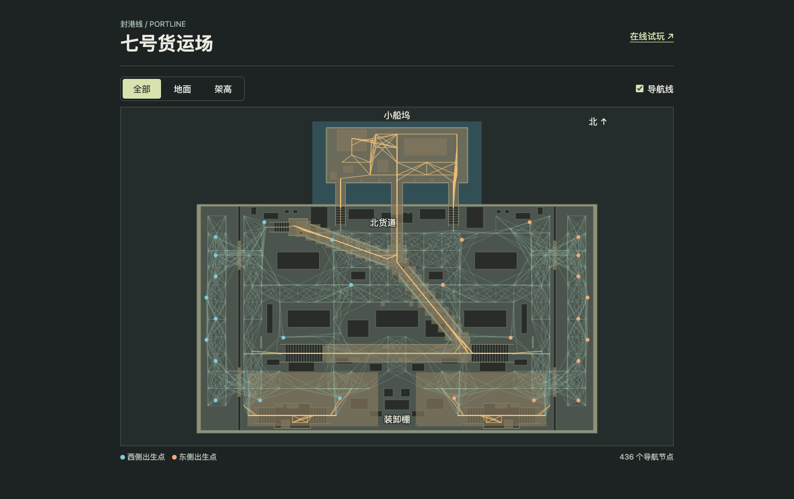

# 封港线 / PORTLINE

《封港线》是一款在浏览器里玩的单机 3D 射击游戏。地图是停运的七号货运场：北边走货道，中间穿箱巷，南边进装卸棚。走天桥可以换线，两侧舷梯也能上船。游戏有死斗、夺旗和靶场。

**[在线试玩](https://37lg9p8tdy1p289urk1.traesite.cn/)** · 建议用电脑 Chrome，点「部署」选模式。

## 这个仓库

这里开源的是七号货运场的关卡数据和地图查看器。数据与 2026 年 11 月 23 日核对的试玩版一致，包含 28 个出生点、725 个碰撞盒和 436 个导航节点。可以单独查看地面、架高路线和船甲板。完整游戏仍在试玩站，本仓库不含游戏运行时和模型。



```sh
python3 -m http.server 8000 --bind 127.0.0.1
```

打开 `http://127.0.0.1:8000/` 看图，无需安装前端依赖。`node --test` 校验数据和路线。数据格式见 [data/README.md](data/README.md)。

本仓库的代码和数据采用 [MIT 许可证](LICENSE)。
